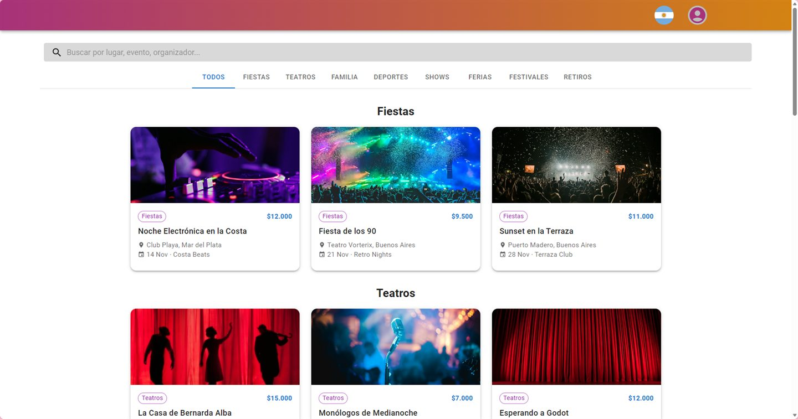

# Custom Web Login System

A complete sign-up / sign-in flow written from scratch: no auth library does the work, every step (accounts, sessions, email verification, Google sign-in) is implemented by hand on a small React + Express + MySQL stack, wrapped in a demo events site. Live at **[kazin.dev/projects/custom-web-login-system](https://kazin.dev/projects/custom-web-login-system/)**.

Made in 2024 by [Elias Lujan (Kazin)](https://kazin.dev) without AI until the first Claude commit (827f62e, 2026-11-05); the deploy, the demo content and this README came after.

[](https://kazin.dev/projects/custom-web-login-system/)

## What a visitor meets

- **Register and sign in** with email and password; server-side validation of the fields and of the email format.
- **Email verification**: a new account stays unverified until verified; this demo sends no mail and offers a "Verificar ahora" button instead.
- **Sign in with Google** as an alternative to the form.
- **Sessions** kept by the server (a UUID per session, cookie on the client), so a refresh or a direct URL keeps the user signed in.
- **Dashboard and profile** pages behind the login; user roles prepared in the schema.
- **The demo site around it**: events in eight categories for Chile and Argentina, a search box, category tabs and a country switch in the navbar that filter them.

## What runs behind it

| Layer | Technologies |
| --- | --- |
| Front end | React 18, React Router 6, Material UI, Bootstrap 5, styled-components, axios, `@react-oauth/google` |
| Back end | Node.js, Express 4, express-session, cookie-parser, Passport (Google OAuth), uuid |
| Database | MySQL 8 (`database.sql`: users, sessions, roles, verification flag) |
| Tooling | Create React App, nodemon |

- The server reads its session secret, port, allowed origins and database login from a settings file (`server/settings.js`), never from the code.
- Behind the reverse proxy the session cookie is secure over HTTPS; the client is built for its base path.

## Running it locally

```bash
# terminal 1
cd client && npm i && npm start
# terminal 2
cd server && npm i && npm start
```

Import `database.sql` into MySQL first and put your Google OAuth client id in `client/src/google-credentials.js` and `server/google-credentials.js`. The server's defaults are in `server/settings.example.json`; copy it to `server/settings.json` to change them.

## Deploying

`node deploy/deploy.mjs` builds the client for the base path, bundles server, common and the built client, and installs everything on the Ubuntu box (`deploy/install.sh`: a system user, the MySQL database and user, a hardened systemd unit, a Caddy path block). Settings are generated on the box.

## Layout

```
client/src/App.js              routes and the app shell;  views/  Home, SignIn, Register, VerifyEmail, Dashboard, Profile
client/src/components/         Navbar (search box, country and account menus), Copyright, Error
common/common.mjs              constants shared by client and server (API address, roles)
server/server.js               Express: /entry, /signin/action, /register/action, /verify_email/action, /logout, /events
server/settings.js             the settings loader;  settings.example.json  the defaults
database.sql                   the MySQL schema
deploy/                        deploy.mjs, install.sh, app.service, app.caddy, deploy.json
docs/screenshots/              the screenshots above
```

## History

- **2024-05**: the login system, built from scratch as the account layer of an events site.
- **2026-11-05**: deployed at kazin.dev/projects/custom-web-login-system; settings file for the secrets; the missing `sessions` table added; the demo events, search and country filter; the verify-now button.
